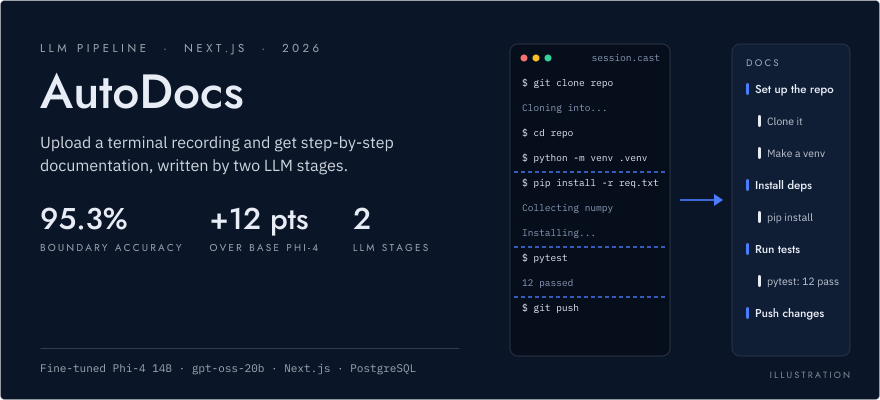
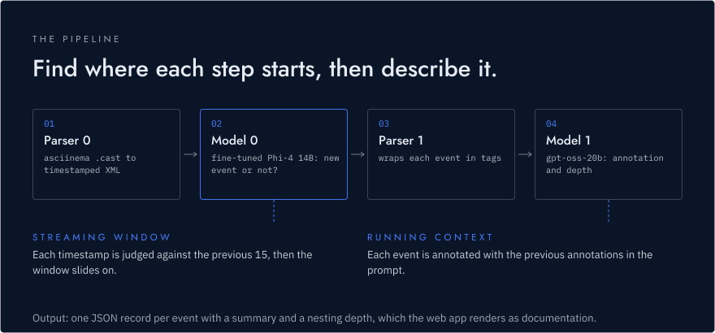
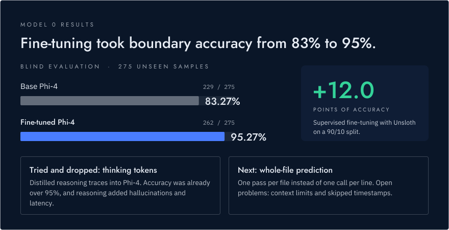
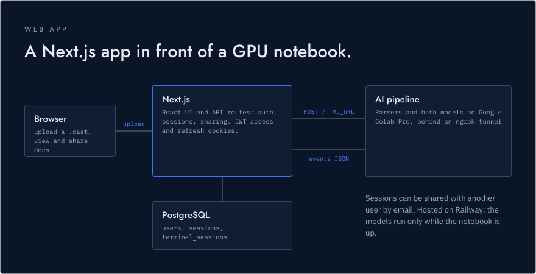

<p align="center">
  <picture>
    <source media="(prefers-color-scheme: dark)" srcset="assets/readme/hero-dark.svg">
    <source media="(prefers-color-scheme: light)" srcset="assets/readme/hero-light.svg">
    
  </picture>
</p>

<p align="center">
  <strong>Upload an asciinema terminal recording and get documentation you can share.</strong><br>
  <strong>95.27% boundary accuracy</strong> on 275 unseen samples, up from 83.27% for base Phi-4<br>
  <sub>Built under the mentorship program of the Human Feedback Foundation and the Linux Foundation, with mentors <a href="https://github.com/julialongtin">Julia Longtin</a> and <a href="https://github.com/arthurwolf">Arthur Wolf</a>. <a href="https://wiki.faikvm.com/mediawiki/index.php/Main_Page#AutoDoc">Project page</a>.</sub>
</p>

<p align="center">
  
  
  
  
  <a href="https://huggingface.co/Jaiccc/model_0_streaming_timestamp"></a>
</p>

<p align="center">
  <a href="https://autodocs-production.up.railway.app">Open the web app</a> &middot; <a href="https://drive.google.com/file/d/1ssCTLpFQCOF0IWctK1j3NYFi1jjNiI9B/view?usp=sharing">Watch the demo</a>
  <br><sub>The models aren't hosted full time because of usage limits, so generation in the hosted app may not work.</sub>
</p>

---

A terminal session is a long, flat stream of commands and output. AutoDocs finds where each logical step starts and ends, then writes a short description of every step and how it nests under the others. The result reads like a how-to written by the person at the keyboard.

## The pipeline

<p align="center">
  <picture>
    <source media="(prefers-color-scheme: dark)" srcset="assets/readme/pipeline-dark.svg">
    <source media="(prefers-color-scheme: light)" srcset="assets/readme/pipeline-light.svg">
    
  </picture>
</p>

1. **Parser 0** converts the asciinema recording into XML with a timestamp on every line.
2. **Model 0 (boundary detection)** is a fine-tuned Phi-4 14B. It works as a stream: for each timestamp it looks at the previous 15 and decides whether a new event starts there. Then the window moves forward.
3. **Parser 1** uses those boundaries to cut the XML into events and wraps each one in event tags.
4. **Model 1 (event annotation)** runs `openai/gpt-oss-20b` on each tagged event. It sees the annotations it already wrote, so it can judge how the new event relates to its neighbours, and it returns a summary and a depth level as JSON.

## Model 0 results

<p align="center">
  <picture>
    <source media="(prefers-color-scheme: dark)" srcset="assets/readme/results-dark.svg">
    <source media="(prefers-color-scheme: light)" srcset="assets/readme/results-light.svg">
    
  </picture>
</p>

Model 0 was trained with supervised fine-tuning in Unsloth on a 90/10 train and evaluation split. On a blind set of 275 samples the model never saw, accuracy went from 83.27% (229/275) for base Phi-4 to 95.27% (262/275), a gain of 12 points. A separate 200-sample check scored 98.00% against 75.50%, but that subset may overlap the training data, so the blind result is the one to quote.

Two experiments didn't make the final model:

- **Thinking tokens.** We distilled reasoning traces from stronger models into Phi-4 so it would explain itself before answering. It trained, but accuracy was already above 95%, and the reasoning added hallucinated logic and slowed each call, which matters when the model runs once per line.
- **Whole-file prediction.** Predicting every boundary in one pass would be much cheaper than one call per timestamp. It is still experimental: long logs overflow the context window, and the model can skip timestamps.

The training data, notebooks and weights are public:

- [Model 0 README](model0/Readme.md) for data processing, training and evaluation
- [Guide to thinking tokens](model0/thinking-tokens/guide_to_thinking.md)
- Training dataset: [Jaiccc/model0_boundary_predict_streaming](https://huggingface.co/datasets/Jaiccc/model0_boundary_predict_streaming)
- Fine-tuned weights: [Jaiccc/model_0_streaming_timestamp](https://huggingface.co/Jaiccc/model_0_streaming_timestamp)

## Web app

<p align="center">
  <picture>
    <source media="(prefers-color-scheme: dark)" srcset="assets/readme/web-app-dark.svg">
    <source media="(prefers-color-scheme: light)" srcset="assets/readme/web-app-light.svg">
    
  </picture>
</p>

The web app is a Next.js app with a PostgreSQL database. Users sign up, upload a `.cast` recording, and read the generated documentation as a nested list of steps. They can also share a session with another user by email. Auth uses signed JWTs in access and refresh cookies, and passwords are hashed with bcrypt.

The [model pipeline](host_pipeline.ipynb) runs on Google Colab Pro and is exposed to the app's API through an ngrok tunnel. The API sends the recording to that endpoint (`ML_URL`), then turns the JSON it gets back into the format the UI displays and stores it.

| Area | Tools |
|---|---|
| Boundary model | Phi-4 14B, fine-tuned with Unsloth (SFT) |
| Annotation model | `openai/gpt-oss-20b` |
| Model hosting | Google Colab Pro, ngrok |
| Web app | Next.js 16, React 19, TypeScript |
| Database | PostgreSQL (Docker for local development) |
| Hosting | Railway |

## Getting started

The web app needs Docker, Node.js and three values in `autodocs-app/.env.local`: `DATABASE_URL`, `JWT_SECRET` and `ML_URL`.

```sh
cd autodocs-app
npm install
npm run db:up      # local Postgres with the schema and two seeded users
npm run dev        # http://localhost:3000
```

The [web app README](autodocs-app/README.md) has the full environment setup and the API reference. To run the models, open [`host_pipeline.ipynb`](host_pipeline.ipynb) in Colab with an `NGROK_AUTHTOKEN` secret. It serves the pipeline with Flask through pyngrok; set `ML_URL` to the tunnel's public URL.

## White paper

To be added.
